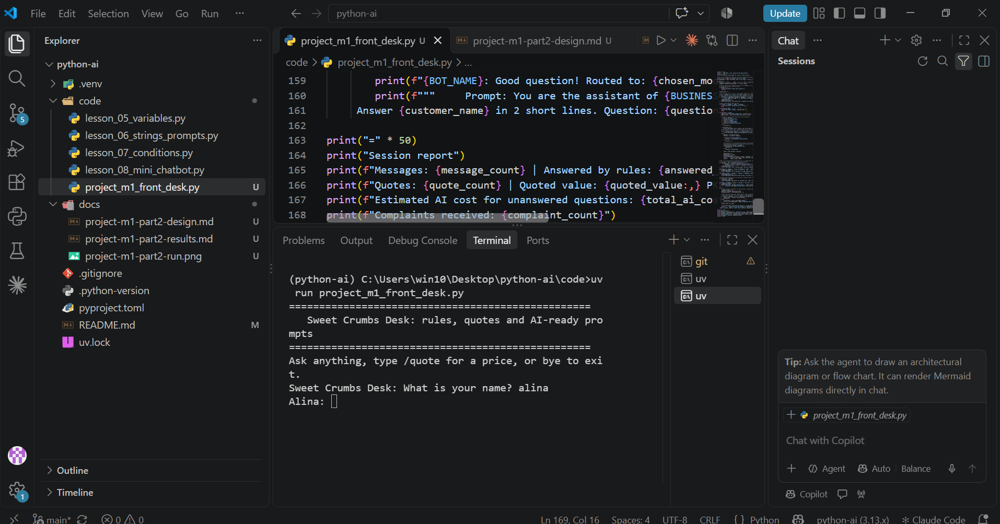

name = Alina Khan
Project = Python-ai

## Task 1.8: Business Helper Bot (City Care Clinic)

A rule-based chatbot for a local clinic. It answers common questions, hands complaints to a manager, and counts the questions it cannot answer so the owner knows what to add next.

**File:** `code/lesson_08_mini_chatbot.py`

### Design table

Rules are checked from top to bottom. The first match wins, so the complaint rule comes first.

| Order | Intent | What the user wants | Keywords to look for | Reply |
|---|---|---|---|---|
| 1 | Complaint | Report a problem | complaint, is late, rude, refund, not happy, wrong | Sorry about that. The clinic manager will call you today. |
| 2 | Human handover (stretch) | Talk to a person | human, agent | Connecting you to a human... (chat ends) |
| 3 | Exit | End the chat | bye (exact match) | Take care, {name}! (chat ends, summary printed) |
| 4 | Greeting | Say hello | hi, hello, salam, assalam (start of message only) | Hello {name}! How can I help you? |
| 5 | Timings | Opening hours | timing, open, hours | We are open 10 am to 8 pm, Monday to Saturday. |
| 6 | Fees | Consultation price | how much, price, cost, fees, the fee, charges | Consultation fee is 2,000 PKR. |
| 7 | Location | Find the clinic | where, address, location | We are at 12 Main Street, City Centre. |
| 8 | Appointment | Book a visit | appointment, book | To book, call 0300-0000000 or tell me your preferred day. |
| 9 | Fallback | Anything else | (no match) | Counted as unanswered, plus the AI prompt for Module 2. |

### Design notes

- Every message is cleaned with `.strip().lower()`, so `"  TIMINGS "` works.
- Short words like "hi" are checked with `==` and `.startswith()`, not `in`, because `"hi" in "which doctor"` is `True`.
- The keyword `"the fee"` is used instead of `"fee"` so that "I feel sick" is not mistaken for a fee question.
- Empty messages are skipped and not counted.
- The address and phone number are placeholders.

### Example run

```
City Care Bot: Hi! Ask about timings, fees, location or appointments. Type 'bye' to exit.
City Care Bot: What is your name? sara malik
Sara Malik: What are your TIMINGS?
City Care Bot: We are open 10 am to 8 pm, Monday to Saturday.
Sara Malik: my report is late
City Care Bot: Sorry about that. The clinic manager will call you today.
Sara Malik: which doctor is best?
City Care Bot: I am not sure yet. In Module 2, an AI will answer: You are the friendly assistant of City Care Clinic. Answer in 2 lines: which doctor is best?
Sara Malik: BYE
City Care Bot: Take care, Sara Malik!
========================================
Chat summary: 4 messages, 1 unanswered.
Complaints received: 1
```

## Module 1 Project: AI Front Desk (Sweet Crumbs bakery)

A front desk bot that answers common questions for free, gives exact price quotes with discounts and delivery fees, and prepares AI-ready prompts for everything else. It ends with a session report the owner can act on.

**Run:** `uv run code/project_m1_front_desk.py`



**Value for the owner:** (write one line, for example: it answers the repeated questions and quotes prices without mistakes, so staff save time every day, and the report shows what customers really ask.)

Docs: [design and tests](docs/project-m1-part2-design.md), [AI test results](docs/project-m1-part2-results.md)